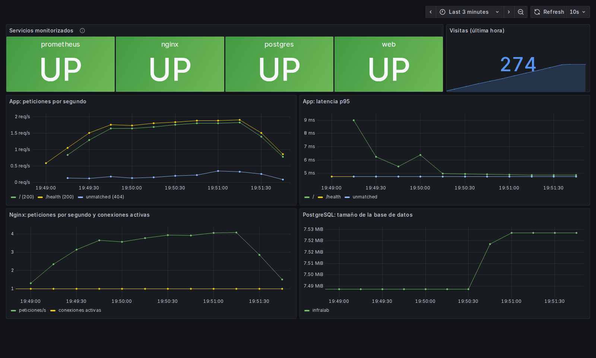
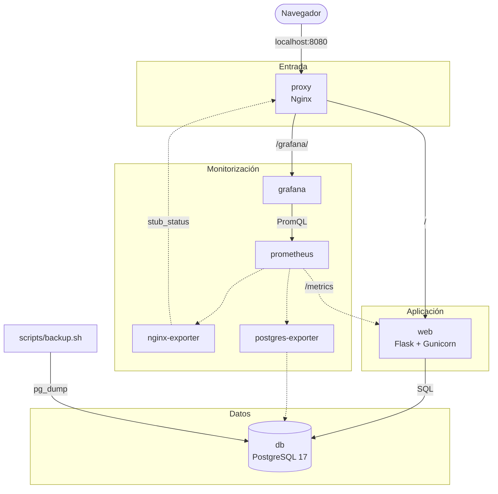
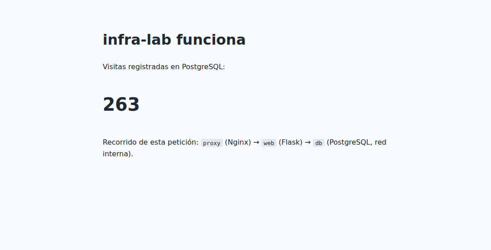

# infra-lab

[](https://github.com/abdark0u/infra-lab/actions/workflows/ci.yml)
[](https://github.com/abdark0u/infra-lab/actions/workflows/security.yml)

Laboratorio de infraestructura con **Docker Compose**: un proxy inverso Nginx delante de una app
web, una base de datos PostgreSQL aislada en una red interna, monitorización con Prometheus y
Grafana, y scripts de backup con rotación y restauración. Se levanta con un solo comando y GitHub
Actions lo prueba entero en cada push.



<sub>Captura real generada por el workflow [Screenshots](.github/workflows/screenshots.yml) con el
stack en marcha y tráfico simulado.</sub>

## Qué demuestra este proyecto

| Área | En este repo |
|------|--------------|
| Contenedores | 7 servicios con Docker Compose, imagen propia que no se ejecuta como root, healthchecks y arranque ordenado |
| Redes y seguridad | 3 redes segmentadas (2 internas), un único puerto publicado, secretos fuera del repo, `/metrics` no expuesto |
| Proxy inverso | Nginx enruta a la app y a Grafana (con websockets) y tiene su propio endpoint de salud |
| Observabilidad | Prometheus con 4 fuentes de métricas, dashboard de Grafana y reglas de alerta, todo como código |
| Backups | Volcados verificados con checksum, rotación, bloqueo contra ejecuciones simultáneas y restauración transaccional |
| CI/CD | GitHub Actions levanta el stack completo y ejecuta 20 bloques de comprobaciones en cada push |
| Seguridad de imágenes | Trivy en cada push y cada lunes: vulnerabilidades, Dockerfile y secretos; la imagen propia está sin vulnerabilidades graves con parche |
| Automatización | Makefile para el día a día y generación de contraseñas aleatorias |

## Arquitectura



Líneas continuas: tráfico de la aplicación. Líneas discontinuas: recogida de métricas.

| Servicio | Imagen | Redes | Puerto publicado |
|----------|--------|-------|------------------|
| `proxy` | `nginx:1.30.6-alpine` | frontend | `8080` → 80 |
| `web` | propia (`python:3.13-slim`) | frontend, backend, monitoring | ninguno |
| `db` | `postgres:17-alpine` | backend | ninguno |
| `prometheus` | `prom/prometheus:v3.15.1` | monitoring | ninguno |
| `grafana` | `grafana/grafana:13.3.0` | frontend, monitoring | ninguno (vía proxy en `/grafana/`) |
| `nginx-exporter` | `nginx/nginx-prometheus-exporter:1.5.3` | frontend, monitoring | ninguno |
| `postgres-exporter` | `prometheuscommunity/postgres-exporter:v0.20.1` | backend, monitoring | ninguno |

| Red | Tipo | Quién está |
|-----|------|------------|
| `frontend` | normal | proxy, web, grafana, nginx-exporter |
| `backend` | `internal` (sin salida a Internet) | web, db, postgres-exporter |
| `monitoring` | `internal` (sin salida a Internet) | prometheus, grafana, web, nginx-exporter, postgres-exporter |

### Decisiones de diseño

- **Una sola puerta de entrada**: solo el proxy publica un puerto. Ningún otro servicio es
  accesible desde el host.
- **Redes internas**: `backend` y `monitoring` usan `internal: true`, así que no tienen salida a
  Internet. El proxy no puede ver ni la base de datos ni Prometheus porque no comparte red con
  ellos; `web` es el único puente entre el proxy y la base de datos.
- **Arranque ordenado con healthchecks**: `db` (`pg_isready`) → `web` (`/health`, que consulta la
  base de datos) → `proxy`. Cada servicio espera a que el anterior esté sano.
- **Secretos fuera del repo**: las credenciales viven en `.env`, que git ignora. `make env` lo crea
  con contraseñas aleatorias y Compose se niega a arrancar si falta alguna.
- **Imagen de la app mínima**: `web` ejecuta Gunicorn con un usuario sin root, aplica los parches
  de seguridad de Debian al construirse y no incluye pip (solo hace falta para instalar).
- **`/metrics` no se expone**: el proxy devuelve `404` en `/metrics`; Prometheus lee las métricas
  de la app directamente por la red `monitoring`.
- **Todo como código**: el datasource y el dashboard de Grafana se cargan por *provisioning* desde
  el repo, y las alertas de Prometheus están en
  [`monitoring/prometheus/alerts.yml`](monitoring/prometheus/alerts.yml).

## Puesta en marcha

Requisitos: Docker con Compose v2, `make` y `curl` (`make lint` usa además `python3`). Se prueba
automáticamente en GitHub Actions (Ubuntu + Docker Engine).

```bash
git clone https://github.com/abdark0u/infra-lab.git
cd infra-lab
make up
```

`make up` crea `.env` con contraseñas aleatorias si aún no existe, construye la imagen de la app y
espera a que todos los servicios estén sanos.

| URL | Qué es |
|-----|--------|
| <http://localhost:8080> | La app: cada visita se guarda en PostgreSQL |
| <http://localhost:8080/grafana/> | Grafana (usuario `admin`; la contraseña es `GRAFANA_ADMIN_PASSWORD` en `.env`) |
| <http://localhost:8080/health> | Salud de la app y de su conexión a la base de datos |
| <http://localhost:8080/healthz> | Salud del propio proxy |



## Comandos (Makefile)

| Comando | Qué hace |
|---------|----------|
| `make up` | Crea `.env` si falta, construye y levanta el stack esperando a los healthchecks |
| `make down` | Para el stack (los datos se conservan en los volúmenes) |
| `make restart` | `down` + `up` |
| `make ps` | Estado de los servicios |
| `make logs` | Logs en vivo (`S=web` para ver solo un servicio) |
| `make health` | Comprueba proxy, app y Grafana a través del proxy |
| `make lint` | Valida Compose, scripts (`shellcheck`), Prometheus (`promtool`) y el JSON del dashboard |
| `make scan` | Escaneo de seguridad con Trivy (ver [Seguridad](#seguridad-trivy)) |
| `make backup` | Backup de PostgreSQL con rotación (`KEEP=14` para conservar 14) |
| `make restore` | Restaura un backup (`FILE=ruta` o `latest`; `YES=1` sin confirmación) |
| `make clean` | Para el stack y **borra** todos los datos (pide confirmación) |
| `make env` | Solo crea `.env` con contraseñas aleatorias (nunca sobrescribe uno existente) |

## Monitorización

Prometheus recoge métricas cada 15 s de cuatro fuentes:

| Job | Origen | Ejemplos de métricas |
|-----|--------|----------------------|
| `web` | `/metrics` de la app (`prometheus_client`) | `infralab_http_requests_total`, `infralab_http_request_duration_seconds`, `infralab_visits_recorded_total` |
| `nginx` | `stub_status` de Nginx vía `nginx-exporter` | `nginx_http_requests_total`, `nginx_connections_active` |
| `postgres` | PostgreSQL vía `postgres-exporter` | `pg_up`, `pg_database_size_bytes` |
| `prometheus` | el propio Prometheus | `up`, `prometheus_tsdb_*` |

El dashboard **infra-lab - Overview** (carpeta `infra-lab` en Grafana) muestra el estado de cada
servicio, las visitas, las peticiones por segundo y la latencia p95 de la app, el tráfico de Nginx
y el tamaño de la base de datos.

Reglas de alerta (visibles en la pestaña *Alerts* de Prometheus):

| Alerta | Se dispara cuando |
|--------|-------------------|
| `TargetDown` | un servicio deja de responder a Prometheus durante 1 min |
| `PostgresDown` | `postgres-exporter` no puede conectar con la base de datos durante 1 min |
| `AppHighErrorRate` | más del 5 % de las respuestas son 5xx durante 5 min |
| `AppHighLatency` | la latencia p95 supera 500 ms durante 5 min |

Prometheus no está publicado. Para abrir su interfaz se puede usar un túnel temporal:

```bash
docker run --rm -it --network infra-lab-monitoring -p 9090:9090 alpine/socat TCP-LISTEN:9090,fork TCP:prometheus:9090
```

## Backups y restauración

[`scripts/backup.sh`](scripts/backup.sh) (o `make backup`) hace un volcado de PostgreSQL y conserva
solo los más recientes:

```bash
./scripts/backup.sh            # conserva los 7 últimos (por defecto)
./scripts/backup.sh -k 14      # conserva los 14 últimos
./scripts/backup.sh -d /ruta   # otra carpeta de destino
```

Paso a paso:

1. Comprueba que `db` está en marcha y toma un **lock** (`backups/.backup.lock`) para que no se
   ejecuten dos backups a la vez.
2. Ejecuta `pg_dump --format=custom` dentro del contenedor y lo escribe en un archivo `.partial`.
3. **Verifica** que el volcado no está vacío y que `pg_restore --list` puede leerlo.
4. Solo entonces lo renombra a `infralab_<fecha UTC>.dump`, así que nunca queda un backup a medias
   con nombre definitivo.
5. Guarda su checksum en `infralab_<fecha UTC>.dump.sha256`.
6. **Rotación**: borra los backups que sobran, empezando por los más antiguos.

Los backups se crean con permisos `600` (solo los lee su propietario) y la carpeta `backups/` está
en `.gitignore`.

Programarlo con cron (todos los días a las 03:00):

```cron
0 3 * * * /ruta/a/infra-lab/scripts/backup.sh >> /ruta/a/infra-lab/backups/backup.log 2>&1
```

[`scripts/restore.sh`](scripts/restore.sh) (o `make restore`) comprueba el checksum, pide
confirmación y restaura con `pg_restore --single-transaction`: si algo falla a mitad, la base de
datos queda como estaba.

```bash
./scripts/restore.sh latest                                  # el backup más reciente
./scripts/restore.sh backups/infralab_20261113T030000Z.dump  # uno concreto
./scripts/restore.sh -y latest                               # sin confirmación (scripts/CI)
```

## Seguridad (Trivy)

[`scripts/security-scan.sh`](scripts/security-scan.sh) (o `make scan`) ejecuta
[Trivy](https://trivy.dev) en Docker, así que no hay que instalarlo. La política separa lo que
depende de este repo de lo que no:

| Comprobación | Si encuentra algo |
|--------------|-------------------|
| Imagen propia `web`: vulnerabilidades HIGH o CRITICAL con parche disponible | **Falla** |
| Dockerfile de la app: errores de configuración HIGH o CRITICAL | **Falla** |
| Secretos (claves, tokens) en los archivos del repositorio | **Falla** |
| Imágenes de terceros (nginx, postgres, Grafana…): vulnerabilidades con parche | Solo informa: se corrigen subiendo de versión |

Se ejecuta en cada push y también cada lunes, porque aparecen vulnerabilidades nuevas aunque el
código no cambie. Los resultados quedan en el resumen de cada ejecución del workflow
[Security](.github/workflows/security.yml).

**Primer escaneo**: la imagen `web` tenía 7 vulnerabilidades HIGH, ninguna en el código de la app:

- 2 en `zlib` (Debian): ya parcheadas por Debian, pero aún no incluidas en `python:3.13-slim`. Se
  corrigieron aplicando las actualizaciones de seguridad al construir la imagen.
- 5 en librerías que pip lleva dentro (`msgpack`, `urllib3`, `setuptools`). pip solo se usa para
  instalar las dependencias, así que se desinstala después y no queda en la imagen.

Resultado: 0 vulnerabilidades graves con parche en la imagen propia.

## Integración continua

| Workflow | Cuándo | Qué hace |
|----------|--------|----------|
| [CI](.github/workflows/ci.yml) | Cada push a `main` y cada pull request | Levanta el stack en un runner limpio y lo prueba entero |
| [Security](.github/workflows/security.yml) | Cada push, cada pull request y cada lunes | Escaneo de seguridad con Trivy (`make scan`) |
| [Screenshots](.github/workflows/screenshots.yml) | A mano | Genera tráfico, abre la app y Grafana en Chromium y guarda las capturas de este README |

La CI usa los mismos comandos `make` que se usan en local y comprueba que:

- `make env` no deja contraseñas por defecto, crea `.env` con permisos `600` y no lo sobrescribe
- Compose, los scripts (`shellcheck`), Prometheus y sus alertas (`promtool`) y el dashboard son
  válidos, y Nginx pasa `nginx -t`
- todos los servicios llegan a `healthy` y responden los endpoints de salud
- cada visita se guarda en PostgreSQL y los datos sobreviven a un reinicio
- los backups se crean con checksum, la rotación conserva exactamente los indicados, el lock impide
  dos backups a la vez, una restauración devuelve los datos exactos del backup y un backup dañado
  se rechaza
- `/metrics` devuelve `404` desde fuera
- Prometheus tiene sus 4 targets en `up` y recibe métricas de la app, Nginx y PostgreSQL
- Grafana responde a través del proxy, su datasource conecta con Prometheus, el dashboard está
  cargado y todos los ficheros de su interfaz se sirven correctamente
- las redes internas lo son de verdad: el proxy no puede resolver ni la base de datos ni
  Prometheus, y ningún servicio salvo el proxy publica puertos

## Estructura del repositorio

```
.
├── Makefile                # comandos del día a día (make help)
├── docker-compose.yml
├── .env.example            # plantilla de variables (el .env real no se sube)
├── .github/
│   ├── workflows/
│   │   ├── ci.yml          # prueba completa del stack en cada push
│   │   ├── security.yml    # escaneo con Trivy (push, PR y cada lunes)
│   │   └── screenshots.yml # capturas para el README (manual)
│   └── scripts/
│       └── capture-screenshots.mjs
├── proxy/
│   └── default.conf        # proxy inverso, /grafana/, stub_status
├── web/
│   ├── Dockerfile          # imagen de la app (usuario sin root)
│   ├── app.py              # Flask: contador de visitas + /health + /metrics
│   └── requirements.txt
├── db/
│   └── init/
│       └── 01-schema.sql   # esquema inicial (solo con el volumen vacío)
├── monitoring/
│   ├── prometheus/
│   │   ├── prometheus.yml  # targets a monitorizar
│   │   └── alerts.yml      # reglas de alerta
│   └── grafana/
│       ├── provisioning/   # datasource y proveedor de dashboards
│       └── dashboards/
│           └── infra-lab-overview.json
├── scripts/
│   ├── init-env.sh         # crea .env con contraseñas aleatorias
│   ├── security-scan.sh    # escaneo de seguridad con Trivy
│   ├── backup.sh           # pg_dump + verificación + checksum + rotación
│   └── restore.sh          # restauración verificada y transaccional
└── docs/img/               # capturas del README
```

## Cómo se construyó

El proyecto se hizo por fases, cada una con su commit y validada por la CI antes de pasar a la
siguiente:

1. Proxy inverso Nginx + web, y la CI en GitHub Actions
2. PostgreSQL en red interna + app con contador de visitas
3. Prometheus + Grafana con dashboard y alertas como código
4. Scripts de backup con rotación y de restauración
5. Makefile, contraseñas aleatorias, capturas y documentación
6. Escaneo de seguridad con Trivy y corrección de lo que encontró en la imagen de la app

## Limitaciones y próximos pasos

- **HTTPS**: el proxy solo sirve HTTP. En un servidor real añadiría TLS con Let's Encrypt.
- **Avisos de alertas**: las reglas se evalúan en Prometheus, pero falta Alertmanager para avisar
  por correo o chat.
- **Backups fuera de la máquina**: ahora se guardan en el mismo host. El siguiente paso sería
  cifrarlos y copiarlos a un almacenamiento externo (por ejemplo, con restic a S3).
- **Secretos**: se pasan como variables de entorno; Docker secrets o un gestor como Vault serían más
  robustos.
- **Escalado de la app**: Gunicorn usa un solo proceso (con 4 hilos) para que las métricas en
  memoria sean completas; con varios procesos haría falta el modo multiproceso de
  `prometheus_client`.
- **Imágenes de terceros desactualizadas**: Trivy informa de vulnerabilidades con parche en las
  versiones fijadas de nginx, PostgreSQL, Prometheus, Grafana y los exporters. El siguiente paso es
  subirlas a sus últimas versiones y comprobar con la CI que todo sigue funcionando.
